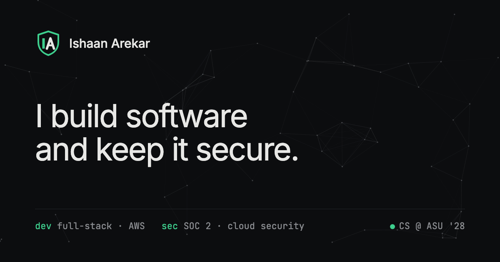

<p align="center">
  
</p>

<h1 align="center">Ishaan Arekar</h1>

<p align="center">
  I build software and keep it secure.<br />
  CS @ Arizona State University '28 · full-stack, AWS &amp; cloud security
</p>

<p align="center">
  <a href="https://ishaanarekar.com"><b>ishaanarekar.com</b></a> ·
  <a href="https://www.linkedin.com/in/ishaan-arekar">LinkedIn</a> ·
  <a href="https://ishaanarekar.com/resume.pdf">Resume</a>
</p>

---

My personal portfolio. It's a static site, hand-written in plain HTML, CSS and JavaScript: no framework, no build step, no trackers.



## What's on it

- **A working terminal.** The panel in the hero is a real (tiny) shell. Expand it with the full-screen button or press <kbd>`</kbd>.
- **Projects** with full write-ups covering the problem, what I built, the security considerations and the outcome. Includes FitStack, ScanTaps, VITRA automation, the Flask Blog Platform and the Weather Desktop Client.
- **Experience, skills and achievements,** split evenly across software engineering and security.
- **A contact form** that delivers to my inbox without publishing an email address.
- **My resume,** to view, download or read inside the terminal.

### Try these in the terminal

```text
help                 list every command
ls                   see what's here
cd projects          browse projects, then: cat fitstack
cat resume           read the full resume (or cd resume for sections)
skills · tracks      shortcuts for each section
goto experience      jump to a section on the page
cat sec.log          the (simulated) security feed
download resume      save the PDF
sudo hire-me         the important one
```

Tab completes, ↑/↓ walk history, Esc leaves full screen.

## Built with

| | |
|---|---|
| Markup & styles | HTML, CSS (design tokens in `:root`, no framework) |
| Behaviour | Vanilla JavaScript |
| Fonts | Inter, JetBrains Mono |
| Contact form | [Web3Forms](https://web3forms.com) |
| Hosting | GitHub Pages, custom domain `ishaanarekar.com` |

Lighthouse: 100 accessibility, 100 best practices and 100 SEO on mobile and desktop; performance 99 on desktop and 90+ on mobile (the terminal boots with a short animation on purpose).

## Project structure

```text
.
├── index.html        the whole site: content, SEO tags, structured data
├── style.css         Hairline Dark theme (colours/spacing are tokens at the top)
├── script.js         nav, project filters, heading decrypt effect, background, contact form
├── terminal.js       the shell: builds its file system from the page itself
├── resume.pdf        downloadable resume
├── resume.txt        text copy of the resume, used by `cat resume` in the terminal
├── assets/           photo, project logos, IA logo
├── 404.html          terminal-style "no such file or directory" page
├── og-image.png      link preview image (LinkedIn, iMessage, Slack)
├── favicon.svg, favicon-32.png, apple-touch-icon.png
├── robots.txt, sitemap.xml
└── CNAME             custom domain for GitHub Pages (ishaanarekar.com)
```

## Run it locally

```sh
git clone https://github.com/IshaanArekar/Portfolio.git
cd Portfolio
python3 -m http.server 5173 --bind 127.0.0.1
```

Then open <http://localhost:5173>. `--bind 127.0.0.1` keeps the server visible only on your own machine.

## Updating content

- **Text, projects, experience:** edit `index.html`. The terminal reads its files from the page, so it updates automatically.
- **Resume:** replace both `resume.pdf` and `resume.txt` with the new version.
- **Project logos:** drop a file in `assets/` with the same name as the one you're replacing.
- **Styles and assets:** after changing `style.css`, `script.js` or `terminal.js`, bump the `?v=` number on their links in `index.html` so browsers pick up the new version.

## Deployment

The site is served by GitHub Pages from the `main` branch (root folder), on the custom domain **ishaanarekar.com**.

DNS records at the registrar:

| Type | Name | Value |
|---|---|---|
| A | `@` | `185.199.108.153` |
| A | `@` | `185.199.109.153` |
| A | `@` | `185.199.110.153` |
| A | `@` | `185.199.111.153` |
| CNAME | `www` | `ishaanarekar.github.io` |

In the repo, **Settings → Pages**: custom domain `ishaanarekar.com`, with **Enforce HTTPS** on.

---

© 2026 Ishaan Arekar. Built by hand · no trackers.
